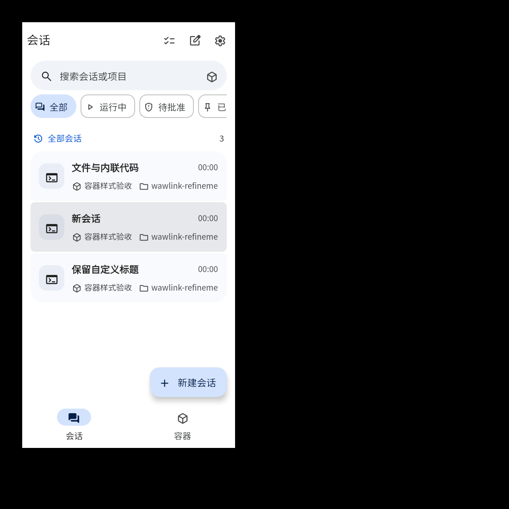
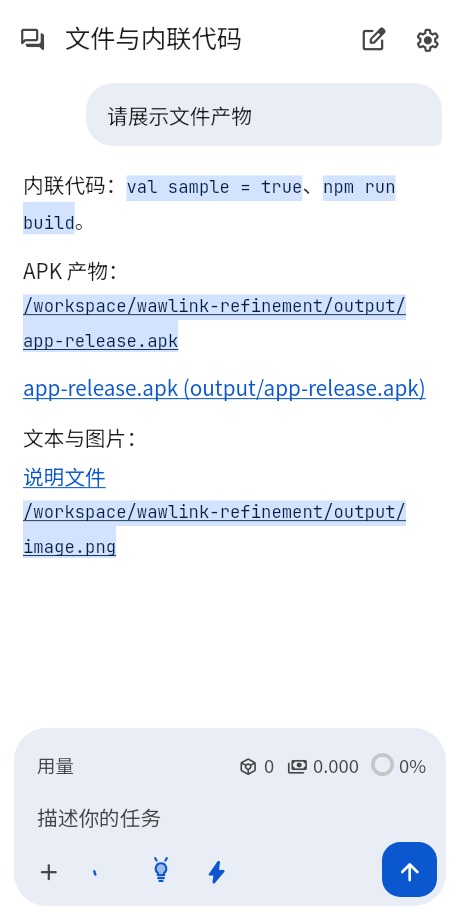
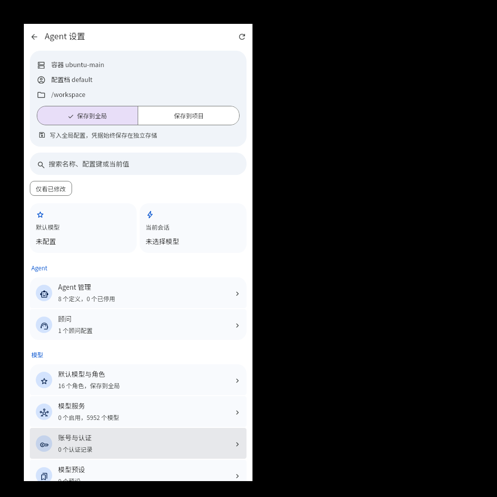
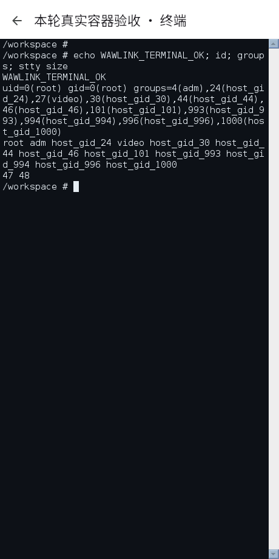
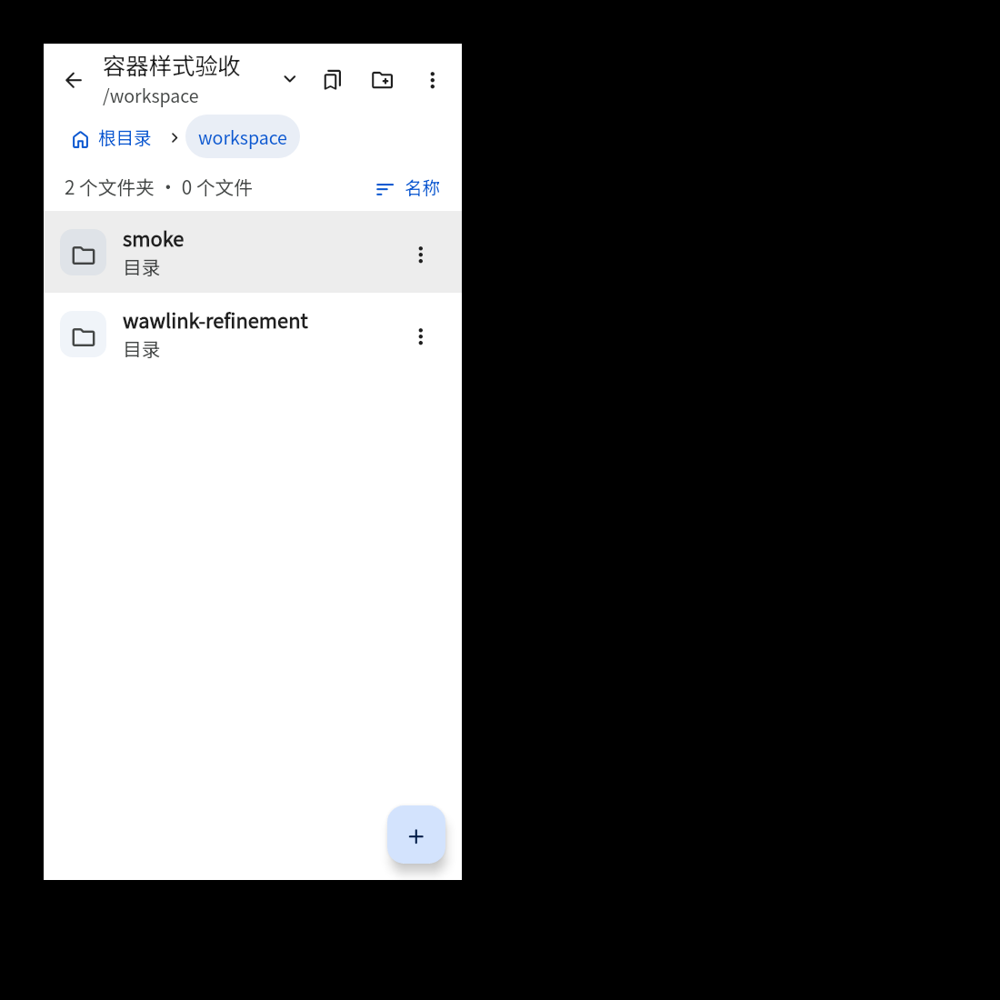

<div align="right">
  <strong>简体中文 · <a href="README_EN.md">English</a></strong>
</div>

<p align="center">
  
</p>

<h1 align="center">WawLink</h1>

<p align="center">
  <strong>装进口袋里的跨端全功能 Coding Agent 工作台。</strong><br>
  在 Android 与 Linux 桌面直接运行真实 Linux 容器、Oh My Pi Agent、代码编辑与流式交互终端。
</p>

<p align="center">
  
  
  
  
  
</p>

<p align="center">
  <a href="https://github.com/wsdx233/WawLink/releases">下载发布</a> ·
  <a href="#快速上手">快速上手</a> ·
  <a href="#核心特性">核心特性</a> ·
  <a href="#从源码构建">源码构建</a> ·
  <a href="https://github.com/wsdx233/WawLink/issues">反馈问题</a>
</p>

---

## 界面预览

<p align="center">
  
  
  
</p>
<p align="center"><sub>会话与容器总览 · Agent 交互与流式思考 · 细粒度模型与 Agent 配置</sub></p>

<details>
<summary><strong>更多截图：集成终端与容器文件管理</strong></summary>
<br>
<p align="center">
  
  
</p>
<p align="center"><sub>真实 PTY 终端 · 容器独立文件管理</sub></p>
</details>

## 关于项目

WawLink 是基于 Kotlin Multiplatform、Compose Multiplatform 与 Material 3 构建的跨端 Coding Agent。

它打破了移动端只能通过网页或远程 SSH 操作大模型工具的局限：通过内置的 **Proroot / PRoot / chroot** 运行时，直接在手机或 Linux 桌面上运行独立的 Linux Rootfs 容器环境；借助 **Oh My Pi (OMP)** 引擎，实现完全原生的本地进程级 Agent 编排、实时工具执行（Bash、文件读写、Grep、Glob、代码编辑等）、完整流式思考与离线图表渲染。

## 核心特性

<table>
  <tr>
    <td width="50%" valign="top">
      <h3>🤖 原生 Agent 交互与思考流</h3>
      <p>一会话一独立 OMP 进程。支持模型流式输出、折叠/全屏思考树、Todo 计划看板、离线 Mermaid/SVG 渲染与代码块语法高亮，原生交互丝滑流畅。</p>
    </td>
    <td width="50%" valign="top">
      <h3>📦 完整的 Linux 容器生态</h3>
      <p>支持 Ubuntu、Debian、Alpine、Arch ARM 等主流发行版镜像。Proroot / PRoot 纯用户态免 Root 运行，亦可使用 Root chroot 获得极速原生性能。</p>
    </td>
  </tr>
  <tr>
    <td width="50%" valign="top">
      <h3>⚙️ 细粒度 Agent 与模型管理</h3>
      <p>统一管理全局与项目级 Agent、Watchdog 顾问、原生角色与模型策略；支持多服务商 Provider 注册、OAuth 授权、模型过滤与故障转移链。</p>
    </td>
    <td width="50%" valign="top">
      <h3>💻 真实终端与容器管理工具</h3>
      <p>集成 Termux 级 JNI PTY 真实终端和等宽快捷键栏，配合全功能文件浏览器、代码编辑器、提示词模板及容器自定义 WebUI 卡片，开箱即用。</p>
    </td>
  </tr>
</table>

## 快速上手

### 1. 安装应用
前往 [Releases](https://github.com/wsdx233/WawLink/releases) 下载最新版本的 APK（Android）或获取桌面构建。

### 2. 准备容器环境
- **在线一键安装**：在应用内进入“容器”页，选择在线发行版（官方源或清华/阿里/中科大国内源），应用会自动拉取并部署。
- **自定义导入**：也可以将自己预置的 `rootfs.tar.xz` 导入应用，支持完整备份与脱敏导入。

### 3. 配置模型服务
进入 **右上角菜单 → 模型服务** 或 **Agent 设置**：
- 添加你的 LLM API 密钥（如 DeepSeek、OpenAI、Claude、Qwen 等兼容服务）。
- 设置主力模型角色与思考档位。

### 4. 开始 Coding！
在主页新建会话，输入你的开发需求。Agent 会自主探索工作区、分析代码、规划任务并调用容器内的 Linux 工具完成任务。

## 系统要求与架构

| 维度 | 支持范围 |
| --- | --- |
| **Android 平台** | Android 8.0 (API 26) 及更高版本，当前支持 `arm64-v8a` |
| **Linux 桌面** | Linux x86_64 / arm64，需 Java 17+ 运行环境 |
| **容器引擎** | Proroot (Android 专属超轻量)、PRoot (兼容通用)、chroot (需 Root 权限) |
| **Agent 核心** | 原生 Oh My Pi (OMP) + Bun 运行时，离线管理通道 |
| **代码高亮** | Android 内置 Sora Editor + TextMate 离线语法库，桌面使用 RSyntaxTextArea |

Rootfs 路径构造使用 Android 8.0 / API 26 已提供的 `Paths.get(...)`，不依赖 Android 14 才加入的 `Path.of(...)`；挂载与链接边界检查仍然保留。

在容器详情页切换 PRoot/Proroot 与 chroot 时，会先解释物理属主转换及可能的长耗时。“开始转换”会停止容器、检查并转换权限后再保存引擎；“暂不转换”保留文件物理属主，只保存目标引擎及暂缓状态，后续启动不会自动补做转换。暂缓可能导致启动或文件访问失败，可在详情页再次选择开始转换；关闭提示则保持原配置。未完成的迁移不能通过暂缓绕过。
工具链安装、卸载及 apt 缓存清理会先以非交互模式执行 `dpkg --configure -a`，自动收尾之前中断的配置事务；修复失败时保留原始错误，不继续执行 apt。

### Android chroot 宿主机 Root 访问

在容器详情的“运行引擎”下开启“宿主机 Root 访问”。配置字段 `hostRootAccess` 默认关闭并独立持久化，仅在 chroot 下生效；PRoot/Proroot 不增加宿主权限。开关沿用现有配置应用流程，运行中的容器会先停止再应用。

开启后将当前 Android 主要共享存储递归挂载到容器 `/sdcard`，并安装 `/usr/local/bin/host-exec`。它使用容器自己的 `chroot` 经 `/proc/1/root` 执行宿主 `/system/bin/sh`，不启动代理服务；需要容器以真实 Root 登录，不会给普通用户提权。命令参数、标准输入/输出、错误输出和退出码直接透传；不带参数进入宿主交互 Shell。

```bash
host-exec id
host-exec cmd package list packages
host-exec /system/bin/sh -c 'getprop ro.build.version.release'

# 容器内 APK 通过 stdin 交给 Android，避免把客体路径当成宿主路径。
apk=/workspace/app.apk
host-exec pm install -r -S "$(stat -c %s "$apk")" - < "$apk"
```

宿主命令使用 Android `PATH`、`ANDROID_ROOT=/system` 与 `ANDROID_DATA=/data`，清除客体动态库注入变量；不修改原始共享存储权限，也不额外申请应用存储权限。实际访问和静默安装仍受 Root 授权、登录身份、FUSE/sdcardfs、SELinux 与设备策略限制，拒绝会保留真实命令错误。

停止、启动失败和注销时，递归子挂载先于父挂载卸载；传播隔离或卸载失败保留清理记录供重试，不用 lazy unmount 冒充完成。关闭开关或切离 chroot 时仅移除本应用原样安装的 `host-exec`，不覆盖、删除用户同名文件。这个开关提供便利入口，不是 chroot Root 的安全隔离或权限撤销边界。

## 从源码构建

项目采用标准 Gradle 构建系统，预置免 Docker 与免 Root 自动化准备脚本。

### 环境要求
- Linux 环境（x86_64 或 aarch64）
- **JDK 17** 及以上
- **Android SDK Platform 35**、**Build Tools 35.0.0** 与 **NDK 27.0.12077973**
- 基础系统工具：`bash`、`python3`、`curl`、`tar`、`flock`

### 1. 运行桌面端
```bash
# 准备环境依赖与本地测试 Rootfs
./scripts/fetch-android-binaries.sh
./scripts/build-debug-rootfs.sh

# 启动桌面端应用 (460 × 920 移动视口模拟)
./gradlew :app-desktop:run
```

### 2. 编译 Android Debug APK
```bash
./scripts/fetch-android-binaries.sh
./gradlew :app-android:assembleDebug
```
产物位置：`app-android/build/outputs/apk/debug/app-android-debug.apk`。

### 3. 构建生产 Release APK
```bash
./scripts/build-release.sh v0.1.2
```
签名脚本会校验证书指纹与 ZIP 对齐，产出固定位于 `app-android/build/outputs/apk/release/`。

## 项目架构

```text
wawlink/
├── agent-protocol/       # 纯 Kotlin 领域契约：会话、事件树、模型服务与设置接口
├── agent-ui/             # 跨端 Compose UI：聊天流、Composer、富媒体渲染与设置
├── agent-driver-omp/     # OMP RPC 驱动：进程池、JSONL 协议通讯与配置同步
├── container-runtime/    # 容器运行时：Proroot/PRoot/chroot、Rootfs 部署、终端与文件服务
├── app-desktop/          # Linux 桌面宿主入口与混合渲染层
├── app-android/          # Android 宿主入口、前台保活服务与系统集成
└── terminal-emulator/    # 移植自 Termux / Love2Droid 的底层 PTY 终端解析与 JNI
```

## 致谢与开源项目

WawLink 汲取并受益于开源社区众多卓越项目：

- **[Love2Droid](https://github.com/wsdx233/Love2Droid)** — 优雅的 Android 终端架构与移动端开发工作台设计灵感。
- **[Oh My Pi](https://github.com/can1357/oh-my-pi)** — 强大的本地 Coding Agent 引擎与工具链。
- **[Termux](https://github.com/termux/termux-app)** — Android 上成熟的终端模拟、PTY 与 Linux 移植方案。
- **[Sora Editor](https://github.com/Rosemoe/sora-editor)** — 卓越的 Android 原生代码编辑器与语法高亮体验。
- **[Jetpack Compose](https://developer.android.com/jetpack/compose) & [Compose Multiplatform](https://www.jetbrains.com/lp/compose-multiplatform/)** — 现代声明式跨端 UI 框架。
- **[Material Symbols](https://fonts.google.com/icons)** — 全应用一致的 Material Design 图标系统。

---

<p align="center">
  Made with ❤️ by <a href="https://github.com/wsdx233">wsdx233</a>
</p>
