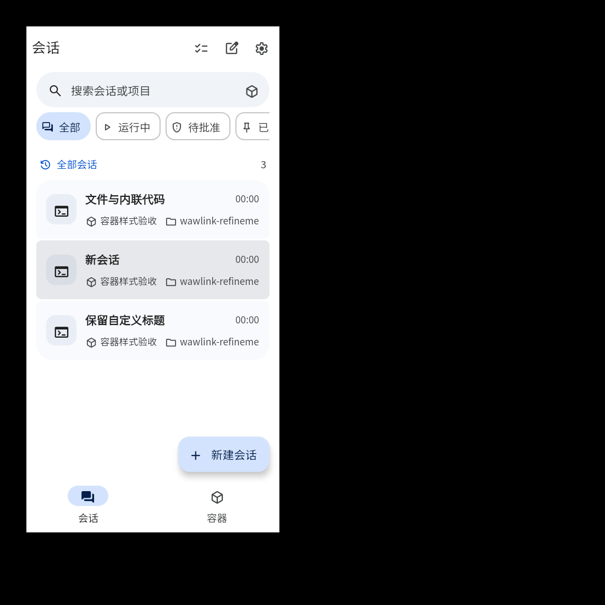
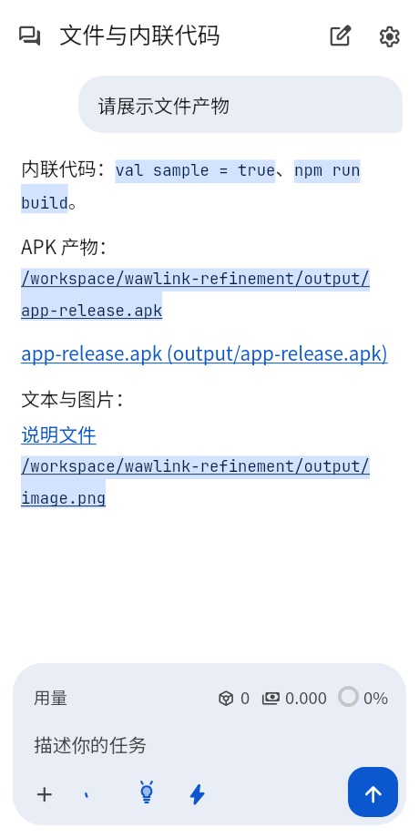
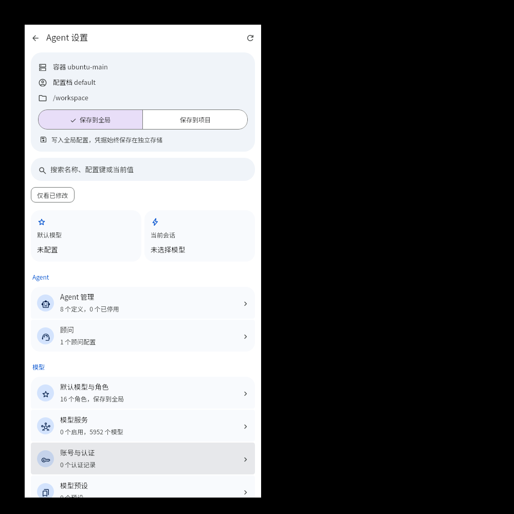
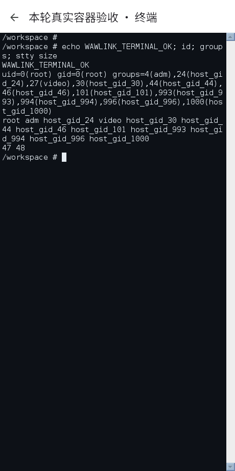
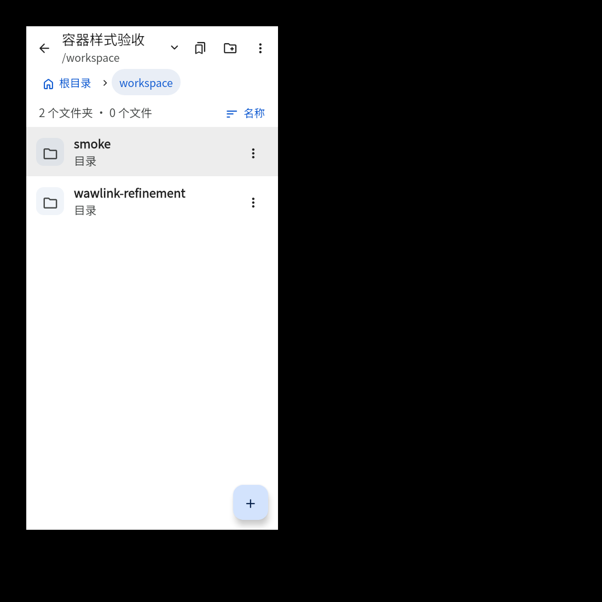

<div align="right">
  <strong><a href="README.md">简体中文</a> · English</strong>
</div>

<p align="center">
  
</p>

<h1 align="center">WawLink</h1>

<p align="center">
  <strong>A pocket-sized, cross-platform full-stack Coding Agent workspace.</strong><br>
  Run real Linux containers, Oh My Pi agents, code editors, and live PTY terminals right on Android™ and Linux Desktop.
</p>

<p align="center">
  
  
  
  
  
</p>

<p align="center">
  <a href="https://github.com/wsdx233/WawLink/releases">Releases</a> ·
  <a href="#getting-started">Getting Started</a> ·
  <a href="#core-features">Core Features</a> ·
  <a href="#build-from-source">Build from Source</a> ·
  <a href="https://github.com/wsdx233/WawLink/issues">Report an Issue</a>
</p>

---

## Screenshots

<p align="center">
  
  
  
</p>
<p align="center"><sub>Sessions &amp; container overview · Agent interaction &amp; streaming thoughts · Detailed model &amp; agent settings</sub></p>

<details>
<summary><strong>More screenshots: Terminal &amp; Container Files</strong></summary>
<br>
<p align="center">
  
  
</p>
<p align="center"><sub>Real PTY terminal · Standalone container file explorer</sub></p>
</details>

## About

WawLink is a cross-platform Coding Agent built with Kotlin Multiplatform, Compose Multiplatform, and Material 3.

It breaks the boundary of mobile AI coding: with built-in **Proroot / PRoot / chroot** runtimes, WawLink brings full Linux Rootfs environments directly onto Android and Linux Desktop. Powered by the **Oh My Pi (OMP)** engine, it delivers local process-isolated Agent orchestration, real-time command execution (Bash, file read/write, grep, glob, code edits), streaming thoughts, and offline diagram rendering.

## Core Features

<table>
  <tr>
    <td width="50%" valign="top">
      <h3>🤖 Native Agent &amp; Streaming Thoughts</h3>
      <p>One isolated OMP process per session. Features model streaming output, collapsible thought trees, Todo kanban, offline Mermaid/SVG diagrams, and syntax-highlighted code blocks.</p>
    </td>
    <td width="50%" valign="top">
      <h3>📦 Real Linux Container Ecosystem</h3>
      <p>Supports Ubuntu, Debian, Alpine, Arch ARM, and more. Rootless user-space execution via Proroot / PRoot, or full native performance with Root chroot.</p>
    </td>
  </tr>
  <tr>
    <td width="50%" valign="top">
      <h3>⚙️ Fine-grained Agent &amp; Model Control</h3>
      <p>Manage global and project-level Agents, Watchdog advisors, native roles, and model policies. Supports multi-provider registration, OAuth, model filtering, and fallback chains.</p>
    </td>
    <td width="50%" valign="top">
      <h3>💻 Real Terminal &amp; File Utilities</h3>
      <p>Termux-grade JNI PTY terminal with an ergonomic shortcut bar, full container file browser, code editor, prompt templates, and custom container WebUI cards.</p>
    </td>
  </tr>
</table>

## Getting Started

### 1. Install the App
Grab the latest release APK (Android) or desktop build from [Releases](https://github.com/wsdx233/WawLink/releases).

### 2. Set Up a Container
- **Online Setup**: Go to the "Containers" tab, pick an online Linux distro (Official or Tsinghua/Ali/USTC mirrors), and let WawLink download and install it.
- **Custom Import**: Or import your own `rootfs.tar.xz` archive with full or sanitized export options.

### 3. Configure Model Providers
Open **Top-right menu → Model Providers** or **Agent Settings**:
- Add your LLM API keys (DeepSeek, OpenAI, Claude, Qwen, etc.).
- Set default model roles and thinking preferences.

### 4. Start Coding!
Create a session on the home screen and tell the Agent what you need. It will autonomously inspect the workspace, plan tasks, write code, and run Linux tools in the container.

## Requirements & Environment

| Area | Support Scope |
| --- | --- |
| **Android** | Android 8.0 (API 26) or newer; `arm64-v8a` |
| **Linux Desktop** | Linux x86_64 / arm64 with Java 17+ |
| **Container Engine** | Proroot (Android lightweight), PRoot (compatible), chroot (Root required) |
| **Agent Engine** | Native Oh My Pi (OMP) + Bun runtime |
| **Code Highlighting** | Sora Editor + offline TextMate grammars on Android; RSyntaxTextArea on Desktop |

Rootfs path construction uses `Paths.get(...)`, available since Android 8.0 / API 26, rather than `Path.of(...)`, which requires Android 14. Mount and link boundary checks remain in place.

Switching between PRoot/Proroot and chroot from container details first explains physical ownership conversion and its potentially long duration. Starting conversion stops the container, checks and converts ownership, then saves the engine. Deferring saves the target engine while retaining physical ownership; later starts do not silently perform the conversion. The target engine may fail to start or access files until you explicitly resume conversion from container details. Dismissing the dialog leaves the configuration unchanged. An unfinished migration cannot be bypassed by deferring.
Toolchain install/remove and apt cache cleanup first run `dpkg --configure -a` in noninteractive mode to finish an interrupted transaction. If repair fails, the original error is preserved and apt is not started.

### Android chroot Host Root Access

Enable **宿主机 Root 访问** (Host Root Access) below the engine selector in container details. The independently persisted `hostRootAccess` field defaults to `false` and only takes effect with chroot; PRoot/Proroot gain no host privileges. Changes follow the existing configuration-application flow, stopping a running container before applying them.

When enabled, Android's current primary shared storage is recursively bound to the guest `/sdcard`, and `/usr/local/bin/host-exec` is installed. It uses the guest's own `chroot` through `/proc/1/root` to execute the host `/system/bin/sh`, without an agent service. The guest must be logged in as real Root; this does not elevate ordinary users. Arguments, stdin, stdout, stderr, and exit status pass through directly. Running it without arguments opens an interactive host shell.

```bash
host-exec id
host-exec cmd package list packages
host-exec /system/bin/sh -c 'getprop ro.build.version.release'

# Stream a guest APK to Android rather than treating its guest path as a host path.
apk=/workspace/app.apk
host-exec pm install -r -S "$(stat -c %s "$apk")" - < "$apk"
```

Host commands use Android's `PATH`, `ANDROID_ROOT=/system`, and `ANDROID_DATA=/data`, with guest dynamic-loader injection variables cleared. The feature does not change shared-storage permissions or request additional app storage permissions. Root authorization, login identity, FUSE/sdcardfs, SELinux, and device policies still determine access and silent-install outcomes; denials retain their real command errors.

Stop, failed startup, and unregister tear down recursive child mounts before their parents. Propagation-isolation or unmount failures retain cleanup records for retry instead of claiming success with lazy unmounts. Disabling the option or leaving chroot only removes the exact app-managed `host-exec`; user-owned files with that name are not overwritten or deleted. This is a convenience interface, not a security-isolation or privilege-revocation boundary for chroot Root.

## Build from Source

WawLink uses a standard Gradle build system with Docker-free preparation scripts.

### Prerequisites
- Linux environment (x86_64 or aarch64)
- **JDK 17** or newer
- **Android SDK Platform 35**, **Build Tools 35.0.0**, and **NDK 27.0.12077973**
- Standard tools: `bash`, `python3`, `curl`, `tar`, `flock`

### 1. Run Desktop Application
```bash
./scripts/fetch-android-binaries.sh
./scripts/build-debug-rootfs.sh
./gradlew :app-desktop:run
```

### 2. Build Android Debug APK
```bash
./scripts/fetch-android-binaries.sh
./gradlew :app-android:assembleDebug
```
Output: `app-android/build/outputs/apk/debug/app-android-debug.apk`.

### 3. Build Production Release APK
```bash
./scripts/build-release.sh v0.1.5
```
Outputs are verified and placed in `app-android/build/outputs/apk/release/`.

## Architecture

```text
wawlink/
├── agent-protocol/       # Pure Kotlin domain contracts: session, event tree, model service
├── agent-ui/             # Cross-platform Compose UI: chat, composer, rich media & settings
├── agent-driver-omp/     # OMP RPC driver: process pool, JSONL protocol & config sync
├── container-runtime/    # Container runtime: Proroot/PRoot/chroot, Rootfs, terminal & files
├── app-desktop/          # Linux desktop host entry & hybrid rendering layer
├── app-android/          # Android host entry, foreground service & system integrations
└── terminal-emulator/    # JNI PTY terminal parser ported from Termux / Love2Droid
```

## Credits & Open-Source Acknowledgments

- **[Love2Droid](https://github.com/wsdx233/Love2Droid)** — Architecture and mobile development workspace layout reference.
- **[Oh My Pi](https://github.com/can1357/oh-my-pi)** — Autonomous Coding Agent engine and toolchain.
- **[Termux](https://github.com/termux/termux-app)** — Android terminal emulation, PTY, and Linux environment porting.
- **[Sora Editor](https://github.com/Rosemoe/sora-editor)** — Native Android code editor and syntax highlighting.
- **[Jetpack Compose](https://developer.android.com/jetpack/compose) & [Compose Multiplatform](https://www.jetbrains.com/lp/compose-multiplatform/)** — Declarative UI framework.
- **[Material Symbols](https://fonts.google.com/icons)** — Material 3 icon design system.

---

<p align="center">
  Made with ❤️ by <a href="https://github.com/wsdx233">wsdx233</a>
</p>
